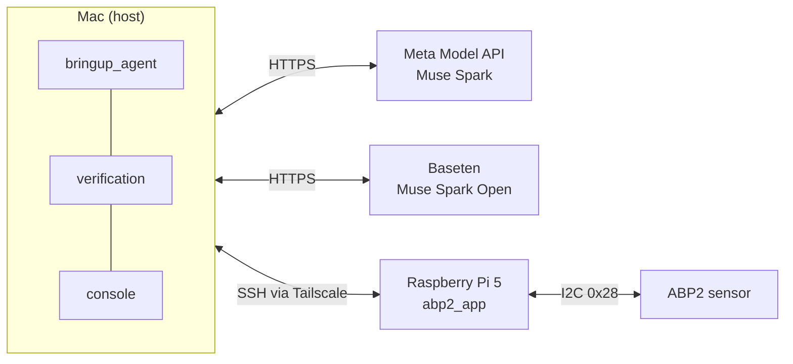

# Bring-Up Bot

An agent that debugs real embedded hardware, fixes it, and proves the fix with an independent hardware test.

Board bring-up costs engineers days of reading datasheets and logs to chase a wrong register value or a misread timing spec. Bring-Up Bot automates that loop: it inspects the board, applies the fix, and re-tests on hardware — each claim is grounded in measured output or datasheet text, and fixes require both kinds of evidence.

## Demo

Video: https://youtu.be/KUl6i8HdIaE

## What it does

Hardware: Raspberry Pi 5 + Honeywell ABP2 pressure sensor (part ABP2DSNT001BD2A3XX, I2C `0x28`, ±1 bar differential). A small app (`pi_app/read_pressure.py`) reads the sensor using settings in `~/abp2_app/config.json`; seeded bugs break that config.

The loop, every run:

1. **Checklist** — the model must state what it will settle before acting.
2. **Inspect** — run an exact-match allowlist of inspection commands (no shell, no arguments) on the Pi, search the ABP2 datasheet; the only write is the app's own sensor measurement command.
3. **Record evidence** — each fact needs a quote from a command output or datasheet snippet; the quote must appear in the source text (case- and whitespace-insensitive match).
4. **Fix** — one `config.json` key at a time, validated and re-tested.
5. **Verify + review** — independent hardware test must pass, then Muse Spark Open independently reviews the final report: every cited finding plus the root cause and fix.

## Meta models and their roles

| Model | Where | Role |
|---|---|---|
| Muse Spark (`muse-spark-1.3`) | Meta Model API | Drives every decision in the loop |
| Muse Spark Open (`meta-models/muse-spark-open-1026`) | Baseten | Independently reviews the final claims, rejects overreach |
| Muse Code | Dev machine | Builder + read-only reviewer during development |

## Why you can trust the result

- Evidence is accepted only if the quote appears in a real command output or a datasheet snippet the model was shown (case- and whitespace-insensitive match).
- Fixes are refused until at least one fact from a Pi command output and one from the datasheet have been recorded.
- Every fix automatically runs `verification/check_abp2.py` (the agent can't edit it) and the app must agree with it within 0.03 bar.
- The final report is refused unless verification passed and Muse Spark Open independently reviews the final report (every cited finding plus the root cause and fix) and accepts every claim — unless the agent declares a physical fault with needs_human: true, which escalates to a person instead.
- 3 refused final reports escalate to a human; every run also has a turn limit.
- Explicit `needs_human` flag for physical faults (wiring, power, missing device).

## Safety

- Exact-match allowlist of inspection commands (no shell, no arguments); the only write is the app's own sensor measurement command.
- Only `~/abp2_app/config.json` can change, validated per key, written atomically (`.tmp` + `mv`) with a `.bak` backup.
- SSH with `BatchMode=yes` (never prompts) and a connect timeout.
- The agent runs on the host Mac, never on the board it may reboot or break.

## Results

| Scenario | Result | Turns | Tokens |
|---|---|---|---|
| gage_range | fixed_and_verified | 13 | 53,783 |
| wrong_address | fixed_and_verified | 17 | 88,404 |
| no_wait | fixed_and_verified | 13 | 30,599 |
| Nov 4 rerun after hardening: gage_range | fixed_and_verified | 18 | 110,064 |

Muse Spark Open caught overreaching claims in all 3 runs and the agent corrected itself before finishing.

## Architecture



## Setup

1. Conda env with Python 3.11, then `pip install openai python-dotenv pypdf fonttools`.
2. `.env` in the repo root with `MODEL_API_KEY` and `BASETEN_API_KEY` (never commit it).
3. SSH alias `bringup-pi` with key auth to the Pi.
4. Enable I2C on the Pi (`raspi-config` → Interface Options → I2C).
5. Wire the sensor (3.3 V only):

| ABP2 pin | Signal | Pi pin |
|---|---|---|
| 1 | GND | 6 (GND) |
| 2 | VDD | 1 (3.3 V) |
| 5 | SDA | 3 (SDA) |
| 6 | SCL | 5 (SCL) |

6. Download the ABP2 datasheet (Honeywell doc 32350268) from Honeywell's website into `docs/ABP2_datasheet.pdf` (not redistributed here).
7. Copy `pi_app/read_pressure.py` (and a `config.json`) to `~/abp2_app/` on the Pi.

## Run it

```bash
scenarios/seed.sh <scenario>                 # plant the bug on the Pi
python bringup_agent/agent.py "<symptom>"    # run the agent
python console/serve.py                      # live view → http://localhost:8765
```

| Scenario | Symptom to report |
|---|---|
| gage_range | App reads ~+0.5 bar with both ports at room air |
| wrong_address | App errors: no response from address |
| no_wait | Busy warning or stale/odd readings |

(`scenarios/seed.sh healthy` restores a good config. `scenarios/ANSWER_KEYS.md` is for scoring only — the agent must never read it.)

## Built during the hackathon

Everything in this repo was built Oct 26 – Nov 4, 2026. The verification design (checklist first, grounded evidence, mandatory checks, escalation) follows the pattern from Meta's Agents 101 workshop; no workshop code is used.

## Future work

- More peripherals (SPI flash, GPIO).
- Boot-time config bugs that need a reboot.
- Muse Wonder as an escalation step before a human.
- Running the full loop on Muse Spark Open for comparison.
